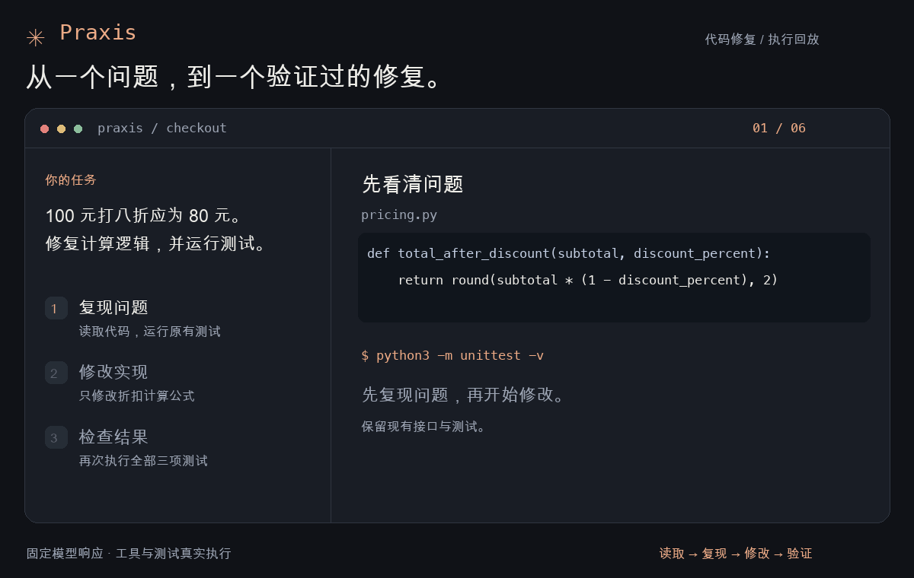

# Praxis

**让 AI 在你的项目里完成工作，而不止于回答问题。**

[](https://github.com/xiaoyinglei/praxis-agent-runtime/actions/workflows/ci.yml)
[](pyproject.toml)
[](LICENSE)

Praxis 是面向个人本机和可信服务器工作区的开源 AI Agent。它可以阅读项目、修改代码、处理数据与文档、查询网页和连接外部服务，并将工具执行、权限审批和聊天历史保存在同一套运行时中。

以 `agent` 命令行为主要入口，也提供 `agent_runtime.Agent` Python SDK。你选择模型和项目，Praxis 负责把请求推进为可检查的行动与结果。

[快速开始](#快速开始) · [使用指南](docs/guide.md) · [开发指南](docs/development.md) · [Ubuntu 部署](DEPLOY_UBUNTU.md)

## 为什么做 Praxis

把模型接进项目后，真正困难的是后面的工作：它能读取哪些文件，哪些操作需要确认，中断后怎样继续，以及“已经完成”究竟有什么依据。

Praxis 把这些事情放进执行流程。模型根据观察规划下一步；文件、命令、网页和集成服务通过明确的工具接口使用；需要授权的动作在执行前暂停。运行结束与任务验收分别记录；需要机器验收时，由用户指定验收命令，Runtime 检查其真实执行结果。

这是一套服务真实任务的运行时，也是一份可以阅读、调试和扩展的 Agent 工程实现。



*100 元打八折却算成了 -1900 元：读取代码 → 复现失败 → 修复公式 → 三项测试通过。演示使用固定模型响应，工具、文件修改与测试均真实执行；画面为执行过程回放，不代表真实模型的任务能力。可通过 `scripts/render_praxis_demo.py` 重新生成。*

## 快速开始

需要 Python **3.12 或 3.13**、Git 和 [uv](https://docs.astral.sh/uv/)。当前支持 macOS 和 Linux；命令执行还需要对应平台的沙箱后端。

从 PyPI 安装后，在你要处理的项目目录启动：

```bash
uv tool install --python 3.12 --link-mode copy praxis-agent
cd /path/to/my-project
agent setup
agent chat
```

参与开发时也可以通过源码安装：

```bash
git clone https://github.com/xiaoyinglei/praxis-agent-runtime.git
cd praxis-agent-runtime
uv sync --locked --link-mode copy

uv run agent setup
uv run agent chat
```

`setup` 会引导你选择或接入模型，验证连接，并保存当前项目的选择。你可以使用云端 API，也可以连接自己启动的兼容模型服务。验证会产生少量真实模型用量。

API Key 在终端中隐藏输入。macOS 使用系统 Keychain，Linux 使用个人配置目录中的私有凭据文件；配置文件保存模型定义与凭据变量名。其他用户下载项目后，配置自己的模型和账号即可使用。

PyPI 安装包名为 [`praxis-agent`](https://pypi.org/project/praxis-agent/)。安装过程、模型要求和本地 MLX 的启动方式见[使用指南](docs/guide.md#安装与首次配置)。

## 用它完成什么

| 场景 | 你可以提出的任务 | 执行方式 |
| --- | --- | --- |
| 理解与修改项目 | “梳理这个项目的入口，修复超时处理并验证。” | 阅读与搜索文件、补丁、命令执行、变更检查 |
| 数据与文档 | “整理这份表格，生成统计图并检查输出文件。” | 结构检查、受限 Python、文件生成与结果回读 |
| 公网检索 | “查阅官方文档，比较这两个方案并给出来源。” | 搜索、网页读取、可选 Chromium 渲染、来源快照 |
| 外部服务 | “查看这个仓库的 Issue，或查找 Notion 中的文档。” | GitHub、Notion、Linear 与自定义远程 MCP |
| 长期项目 | “继续上次的工作，沿用我确认过的项目约定。” | 聊天恢复、可选工作区记忆、可选私有知识库 RAG |

工作区以启动命令时所在的目录为准。处理其他项目时，先进入项目目录，再指定 Praxis 的源码位置：

```bash
cd /path/to/my-project
uv run --project /path/to/praxis-agent-runtime agent setup
uv run --project /path/to/praxis-agent-runtime agent chat
```

在聊天中直接描述目标即可。工具记录可以展开查看，写入和执行授权会单独呈现。需要一次性执行任务时：

```bash
# 只做分析，不要求修改工作区
uv run agent run "阅读 pyproject.toml，解释项目入口和模块职责。" \
  --no-require-workspace-change

# 修改类任务：要求实际变更，并运行用户指定的验收
uv run agent run "修复配置加载中的异常处理，更新相关测试并验证。" \
  --require-workspace-change --acceptance-command "uv run pytest -q"
```

常用聊天命令集中在 `/help` 中：

| 命令 | 用途 |
| --- | --- |
| `/model` | 选择模型，下一条消息生效并保留历史 |
| `/permissions` | 查看或调整当前权限 |
| `/connections` | 打开本机服务连接管理 |
| `/resume` | 选择并打开已保存的聊天 |
| `/new` | 开始空上下文的新聊天 |
| `/copy` | 复制最近回答的原始 Markdown |

## 过程可见，权限可控

Praxis 以 Thread 保存聊天，以 Turn 表示一次请求，以 Step 推进模型与工具交互。执行事件、工具结果和恢复状态写入持久记录，界面只是这些记录的呈现。

```text
用户请求 → 模型规划与观察 → 工具执行 → 结果检查与回复
                  ↑           │
                  └─ 工具结果 ─┘
                       │
               权限检查 · 人工审批 · 持久记录
```

文件读取、工作区写入、命令执行和网络访问分别约束。可以只允许读取某个外部资料目录，也可以选择只读模式；个人授权仍受管理员策略上限限制。

- **命令与 Python：**macOS 使用 Seatbelt，Linux 使用 Bubblewrap。默认只读、禁网络；额外的联网或工作区写入需要授权。Linux 写入先进入私有候选工作区，成功并通过检查后才发布变更。
- **外部服务：**通过 `uv run agent connections` 管理账号。个人远程 MCP 在需要调用时连接；缺少认证或工具目录时才显示连接提示，点击后由你选择登录，不会在普通聊天中自动弹授权页。
- **聊天与记忆：**`agent resume` 打开历史聊天；可选记忆按工作区隔离、默认关闭，来源与修改可检查。记忆生成与 RAG 是独立能力。
- **结果与验证：**运行结束不等于答案已经证实。`AgentResult.validation_status` 区分未评估、通过和失败，`validation_scope` 说明实际检查范围；只读分析可以直接回答，不制造修改证据。

操作方法和配置示例见[使用指南](docs/guide.md)。

## Python SDK

CLI 与 SDK 使用同一套运行时。在已有模型配置的项目中，可以直接嵌入你的 Python 程序：

```python
import asyncio
from pathlib import Path

from agent_runtime import Agent


async def main() -> None:
    agent = Agent(workspace_path=Path.cwd())
    result = await agent.run(
        "阅读当前项目，解释主要模块的职责。",
        require_workspace_change=False,
    )
    print(result.answer)
    print(result.validation_status)


asyncio.run(main())
```

多轮聊天使用 `async with agent.session()` 和 `session.submit()`；实时事件使用 `agent.stream()`。恢复一个暂停的 Turn 使用 `agent.resume()`，与打开历史聊天的 CLI `agent resume` 语义不同。[查看 SDK 与扩展方式](docs/guide.md#python-sdk-与扩展)。

## 适用范围与项目状态

Praxis 适合个人本机开发、可信服务器上的项目工作，以及 Agent 运行时的学习与二次开发。当前版本为 `0.1.0`，接口仍在演进，尚不提供多租户远程执行服务，也不承诺隔离任意恶意仓库或不可信操作者。

macOS 沙箱依赖 `/usr/bin/sandbox-exec`，Linux 依赖 `/usr/bin/bwrap`；需要命令联网时还依赖 libseccomp。后端缺失或无法表达当前策略时会拒绝执行，不降级为无约束进程。Linux 子进程的外部目录写入暂不支持，Windows 尚未完成支持。

CI 覆盖类型、导入边界、回归测试、沙箱和浏览器检查、安装包及公共入口。测试桩只验证测试流程，不能代替真实沙箱验证；历史评估不代表当前版本或任意任务的模型质量。任务效果还取决于模型、权限和输入资料。

## 文档与参与开发

| 文档 | 内容 |
| --- | --- |
| [使用指南](docs/guide.md) | 安装、模型、聊天、连接、权限、记忆、检索与 SDK |
| [开发指南](docs/development.md) | 代码结构、设计原则、检查命令与贡献流程 |
| [Ubuntu 部署](DEPLOY_UBUNTU.md) | Linux 沙箱、依赖安装和运行环境 |

```bash
uv run ruff check .
uv run mypy
uv run lint-imports
uv run pytest -q
```

欢迎通过 Issue 描述问题或提交 PR。问题报告请附平台、Python 版本、启动命令和脱敏错误信息；运行与恢复日志也应先检查是否含有个人资料。

采用 [MIT](LICENSE) 许可证。
